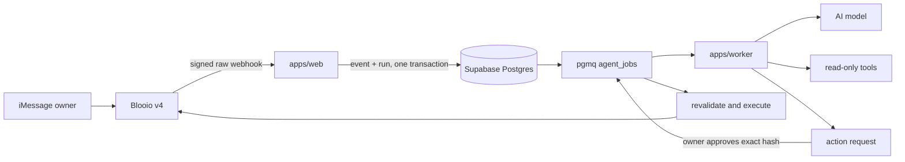

# Agent overview

Read this first when extending OpenInstinct. It describes what the system is, where behavior lives, which invariants must survive every change, and the shortest safe path for adding features.

The source of truth, in descending order, is:

1. Database migrations and executable domain code
2. Tests
3. This overview and the other documentation

If the code and this document disagree, confirm the intended behavior, fix both, and add a regression test.

## Product contract

OpenInstinct is an open-source personal assistant for one owner per deployment. The owner talks to it through iMessage via Blooio v4. A small web control plane exists only for onboarding, connectors, approvals, and audit visibility; do not turn it into another chat interface.

The assistant can read connected services, reason over recent conversation context, propose consequential actions, and execute an approved proposal. Supabase Postgres is the durable source of truth. Web and worker compute can move between providers without changing the domain model.

Current integrations are:

- Blooio v4 for inbound and outbound iMessage
- Google OAuth for Gmail and Calendar
- Generic remote MCP over HTTPS for long-tail connectors
- Kernel behind a provider-neutral cloud-browser interface
- Direct OpenAI, Anthropic, and Google inference with optional OpenRouter, Vercel AI Gateway, or OpenAI-compatible endpoints
- Vercel, containers, or other Node hosts for compute
- Supabase Postgres, Auth, Row Level Security, and `pgmq`

## Runtime in one minute



1. `apps/web` verifies the Blooio signature against the exact, size-bounded raw request body before parsing it.
2. `packages/db` deduplicates the provider event and atomically creates the message, agent run, and `process_event` queue job.
3. `apps/worker` claims the durable job, loads bounded context, and runs the agent for a bounded number of steps.
4. Safe reads may execute inline. A write or communication becomes an immutable `action_request`; the run moves to `waiting_approval`.
5. The authenticated owner approves or denies the exact canonical input hash.
6. Approval queues `resume_run`. The worker revalidates the connector identity, configuration version, and tool allowlist before executing the stored input.
7. The outcome and audit trail are persisted, and a deterministic outbound message is sent through Blooio.

HTTP requests are triggers, not the source of truth. Durable state and the queue live in Postgres.

## Non-negotiable invariants

Preserve these in every feature:

1. **One owner, one deployment.** `OWNER_EMAIL`, the exact E.164 owner phone, database constraints, and RLS all enforce the boundary. Do not generalize to multi-tenant behavior accidentally.
2. **Authenticate before parsing or acting.** Verify public webhook signatures against raw bytes, enforce body limits, and authenticate internal routes with server-only secrets.
3. **Ingestion is idempotent.** A provider retry must not create another run. Keep event insertion and job creation atomic.
4. **The queue is authoritative.** Never rely on an in-memory task, a long-lived HTTP request, or a provider callback alone for durable progress.
5. **The model cannot directly perform consequential actions.** Reads can be automatic. Writes and communications require a persisted proposal and policy decision. Financial, destructive, and security actions are denied unless the policy is deliberately redesigned and reviewed.
6. **Approval binds exact intent.** Hash canonical input and include the exact connector account/configuration version. Execute the stored payload; never ask the model to recreate it after approval.
7. **Revalidate at execution time.** Confirm workspace, action state, expiry, provider, connector, tool allowlist, account, and configuration version immediately before the side effect.
8. **Ambiguous writes are not retried.** Prefer provider idempotency keys. If a timeout or crash leaves completion uncertain, record `unknown`, notify the owner, and require reconciliation instead of replaying it.
9. **Secrets stay server-side and encrypted.** Connector credentials are AES-256-GCM encrypted at rest. Never put tokens in model context, browser output, logs, CLI arguments, committed files, or client-visible API responses.
10. **Remote MCP is hostile input.** Require HTTPS, block redirects and private/special IP ranges at the transport layer, bound responses, validate schemas, and require approval for every MCP invocation.
11. **Database exposure is explicit.** Every Data API table needs intentional grants, RLS, and SQL tests. Workers use direct Postgres credentials; browsers receive only owner-safe views and server-mediated operations.
12. **Provider code stays at the edge.** Core policy and state must not depend on Vercel, Blooio, Google, Kernel, or a specific model provider.
13. **Model fallback is step-local and explicit.** A configured fallback may retry a failed generation before its tool call executes. Never restart an entire agent run for provider failover because earlier tool calls may already have completed.

## Repository map

| Area                         | Owns                                                                                                          | Start here                                                                                                             |
| ---------------------------- | ------------------------------------------------------------------------------------------------------------- | ---------------------------------------------------------------------------------------------------------------------- |
| `apps/web`                   | Owner control plane, auth, onboarding, public webhooks, connector callbacks, approvals, bounded queue trigger | `app/api/webhooks/blooio/route.ts`, `app/api/approvals/[id]/route.ts`, `app/api/internal/consume/route.ts`, `proxy.ts` |
| `apps/worker`                | Agent tools, direct model providers and fallback, job processing, side-effect execution, retries              | `src/models.ts`, `src/agent.ts`, `src/processor.ts`, `src/consumer.ts`                                                 |
| `apps/cli`                   | Agent-friendly setup, diagnostics, webhook provisioning, smoke tests                                          | `src/index.ts`                                                                                                         |
| `packages/core`              | Provider-independent schemas, canonical hashing, policy, run state machine, system prompt                     | `src/domain.ts`, `src/policy.ts`, `src/state-machine.ts`, `src/prompt.ts`                                              |
| `packages/db`                | The only direct SQL access layer, repositories, encrypted credentials, queue job schemas                      | `src/store.ts`, `src/jobs.ts`, `src/crypto.ts`                                                                         |
| `packages/messaging`         | Blooio v4 protocol, signature verification, message normalization and sending                                 | `src/client.ts`, `src/signature.ts`, `src/types.ts`                                                                    |
| `packages/connectors`        | Direct Google OAuth/API and generic remote MCP transports                                                     | `src/google.ts`, `src/mcp.ts`, `src/types.ts`                                                                          |
| `packages/browser`           | Provider-neutral browser contract and Kernel adapter                                                          | `src/provider.ts`, `src/kernel.ts`                                                                                     |
| `packages/runtime`           | Environment validation and portable deployment contracts                                                      | `src/env.ts`, `src/deployment.ts`                                                                                      |
| `supabase`                   | Schema, constraints, RLS, grants, functions, `pgmq`, database tests                                           | `migrations/20260827185247_initial_schema.sql`, `tests/schema.test.sql`                                                |
| `infra/cloudflare-scheduler` | Free one-minute trigger for the bounded consumer endpoint                                                     | `src/index.ts`, `wrangler.jsonc`                                                                                       |
| `docs/deployment`            | Supported hosting profiles and secret wiring                                                                  | `README.md`                                                                                                            |

Do not duplicate domain types. Put a Zod schema at the package boundary that owns the data and infer its TypeScript type.

## State and data model

The important durable records are:

- `workspaces` and `owner_phone_numbers`: singleton ownership boundary
- `conversations`, `messages`, and `inbound_events`: messaging history and deduplication
- `agent_runs`: durable orchestration state
- `action_requests` and `approvals`: immutable proposed intent and owner decision
- `connections`: encrypted provider configuration and credentials
- `scheduled_triggers`: future proactive work
- `memories`: owner context with vector support
- `audit_events`: security-relevant history
- `browser_profiles`: references to provider-side browser state, not raw secrets

Run states are defined in `packages/core/src/domain.ts` and enforced by `state-machine.ts`:

```text
queued -> running -> completed
                  -> waiting_approval -> queued
                  -> waiting_event -> queued
                  -> failed -> queued
                  -> cancelled
```

Action states are:

```text
pending -> approved -> executing -> executed
                              \-> failed
                              \-> unknown
        -> denied
        -> expired
```

Do not add ad hoc status strings. Update the owning Zod schema, state rules, migration constraints if applicable, repository methods, and tests together.

## How to add a direct connector

Use a direct connector when scopes, data types, and risk are stable enough to model explicitly.

1. Add provider-neutral connector types in `packages/connectors/src/types.ts` and the provider implementation beside `google.ts`.
2. Keep OAuth and token refresh inside the connector package. Store encrypted credentials only through `packages/db`.
3. Add read tools in `apps/worker/src/agent.ts` with narrow Zod inputs and bounded outputs.
4. For a write, make the tool create an `ActionRequest`; do not call the provider from the model tool.
5. Put all actual write execution in `apps/worker/src/processor.ts`. Revalidate connector id, account identity, configuration version, allowed operation, and payload hash there.
6. Use a deterministic provider id or idempotency key where the API supports it. Map ambiguous failures to `unknown`.
7. Add OAuth/control-plane routes in `apps/web`, environment validation in `packages/runtime`, and setup/doctor support in `apps/cli`.
8. Add unit tests, database tests if storage changes, and an end-to-end smoke path that does not expose credentials.

## How to extend generic MCP

MCP is the long-tail integration path. Keep the existing network protections in `packages/connectors/src/mcp.ts`; application-level URL checks alone are insufficient because DNS can change between validation and connection.

- Register configuration through the authenticated web control plane.
- Discover and expose only explicitly allowed tools.
- Treat tool descriptions and results as untrusted data, not instructions.
- Bound argument and response sizes.
- Persist every invocation as an action request, even if the remote tool claims to be read-only.
- Recheck the server and `configVersion` during execution.

## How to add another messaging channel

Keep Blooio behavior in `packages/messaging`; do not scatter provider payloads through core or worker code.

1. Define a normalized inbound event and a channel-specific signature verifier/client.
2. Add a small ingress route that verifies raw bytes, applies a strict size limit, then normalizes.
3. Reuse the transactional ingestion method in `packages/db` and give provider event ids a collision-safe namespace.
4. Implement idempotent outbound delivery and deterministic message keys.
5. Preserve the one-owner allowlist before creating any run.

## How to add browser automation

Implement providers behind `BrowserProvider` in `packages/browser`. The current Kernel adapter bounds program size and runtime. Browser execution is intentionally not exposed as a free-form autonomous model tool.

To expose a browser capability, define a narrow named operation, classify its risk, persist writes as action requests, and execute the approved operation in the worker. Never pass arbitrary credentials or an unrestricted browsing program from model output directly to a browser provider.

## How to change the database

Create a new timestamped migration; never edit an already-applied migration after release.

- Add constraints as well as application validation.
- Enable RLS and write policies before granting Data API access.
- Keep encrypted columns inaccessible to browser roles; expose a safe view when necessary.
- Update `packages/db/src/store.ts` instead of issuing SQL from another package.
- Add or update `supabase/tests/schema.test.sql`.
- Test locally with `pnpm supabase:reset` and `pnpm supabase:test`.

## Common feature routing

| Change                   | Primary files                                                                             | Also inspect                                                              |
| ------------------------ | ----------------------------------------------------------------------------------------- | ------------------------------------------------------------------------- |
| New agent read tool      | `apps/worker/src/agent.ts`                                                                | connector implementation, prompt, output bounds, tests                    |
| New consequential action | `packages/core/src/policy.ts`, `apps/worker/src/agent.ts`, `apps/worker/src/processor.ts` | domain hash/schema, DB store, approval UI, idempotency tests              |
| New event or job type    | `packages/core/src/domain.ts`, `packages/db/src/jobs.ts`                                  | store transaction, consumer, state machine, migration constraints         |
| New OAuth provider       | `packages/connectors`, `apps/web/app/api/connectors`                                      | encrypted connection storage, runtime env, CLI doctor, callback allowlist |
| New hosting target       | `packages/runtime/src/deployment.ts`, `apps/cli/src/index.ts`                             | Dockerfiles, scheduler/worker mode, deployment docs                       |
| New model provider       | `apps/worker/src/models.ts`, `packages/runtime/src/env.ts`                                | provider package, CLI doctor, `.env.example`, fallback tests, README      |
| New owner-visible data   | migration, `packages/db/src/store.ts`, `apps/web`                                         | grants, RLS, safe views, SQL tests                                        |
| New proactive behavior   | `scheduled_triggers`, queue producer, worker                                              | owner controls, rate bounds, quiet hours, deduplication                   |

## Local workflow

Use Node 22 and pnpm 10.

```bash
corepack enable
pnpm install
pnpm run setup -- --target vercel --database hosted --json
pnpm run openinstinct -- configure-supabase --project-ref <project-ref>
pnpm exec supabase db push --linked
pnpm run doctor -- --target vercel --phase bootstrap --json
```

Hosted Supabase is the normal setup path. Use the local stack only for database development with `pnpm supabase:start` and `pnpm supabase:reset`. For setup or infrastructure work, run `doctor` before making changes. It emits machine-readable output and stable exit codes. `bootstrap` omits the not-yet-created webhook secret; `ready` requires it. Never print `.env.local` or pass secret values as CLI arguments. See `docs/agent-setup.md` for MCP, CLI, browser-fallback, and confirmation boundaries, and `docs/google-setup.md` for the Gmail and Calendar OAuth runbook.

Before handoff:

```bash
pnpm check
pnpm build
pnpm supabase:test
pnpm run smoke -- --url http://localhost:3000 --json
```

Run the checks that require live services when those services are available. If one cannot run, report the exact missing dependency; do not describe it as passing.

## Deployment profiles

- **Lowest-friction hobby setup:** Vercel Hobby for `apps/web`, Supabase, and the included Cloudflare Worker Cron Trigger for one-minute queue consumption.
- **No Vercel:** deploy the web and worker container targets to Cloud Run or another Node/container host, with a scheduler invoking the bounded consumer if no continuous worker is running.
- **Self-hosted:** Docker Compose runs web and worker against the configured Supabase/Postgres project.
- **Lower latency:** run `apps/worker` continuously instead of waiting for a one-minute scheduler tick.

Compute must remain disposable. A deployment change must not move durable run or approval state out of Postgres.

## Definition of done

Before considering a feature complete, verify:

- The owner can discover and configure it without editing source code.
- Setup and health problems are visible through CLI `doctor` or the control plane.
- Inputs and outputs have schemas and size/time bounds.
- Public and internal entry points authenticate before work begins.
- Retries cannot duplicate inbound events, runs, messages, or external writes.
- Writes cross the proposal/approval/execution boundary and preserve the exact approved payload.
- Secrets remain encrypted, server-only, absent from logs, and ignored by Git.
- New database objects have constraints, least-privilege grants, RLS, and SQL tests.
- Failure, timeout, stale configuration, denial, expiry, and ambiguous completion paths are tested.
- `pnpm check`, `pnpm build`, relevant database tests, and the applicable smoke test pass.
- README, this overview, deployment docs, `.env.example`, and CLI help are updated when the operator experience changes.

## Intentional limitations

- It is single-owner, not multi-tenant SaaS.
- The web app is a control plane, not a primary conversation surface.
- Generic MCP calls always require approval.
- Browser automation is provider-abstracted but not an unrestricted agent tool.
- Some APIs cannot prove whether a timed-out write completed. Those actions become `unknown` and require owner reconciliation.
- Proactive schedules and memory tables exist as foundations; broad autonomous behavior should be added incrementally with explicit owner controls and auditability.

For architectural rationale, read [`architecture.md`](architecture.md). For operator steps, read [`deployment/README.md`](deployment/README.md). For disclosure and security expectations, read [`../SECURITY.md`](../SECURITY.md).
