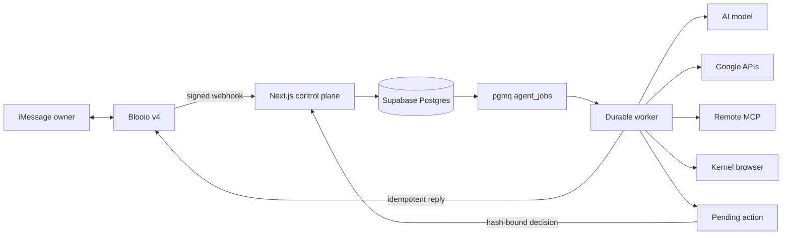

# Architecture

## Runtime boundaries

`apps/web` is the control plane and public webhook ingress. It verifies the exact raw Blooio request body before parsing, authenticates the owner through Supabase Auth, completes connector OAuth, and records approvals.

`apps/worker` claims pull-based `pgmq` jobs with a visibility timeout. It builds bounded conversation context, invokes an AI SDK `ToolLoopAgent`, and writes every run transition. Vercel can invoke the same consumer in short batches; long-running hosts use the worker HTTP process.

`packages/core` contains provider-independent state, policy, canonical hashing, and prompts. `packages/db` is the only direct SQL layer. `packages/messaging`, `packages/connectors`, and `packages/browser` isolate third-party APIs. `packages/runtime` owns environment validation and safe subprocess orchestration.

## Event and action lifecycle

1. A signed Blooio event is inserted once by provider event id.
2. The owner phone is matched and a run plus queue job are committed in one transaction.
3. The worker claims the message, loads the latest 50 conversational messages, and executes at most eight model/tool steps.
4. Reads can complete inline. A consequential tool call is converted into an immutable action request and the run enters `waiting_approval`.
5. Approval checks the authenticated workspace and exact input hash, then enqueues `resume_run`.
6. Execution revalidates the provider/tool, performs the call, marks the action executed, and sends an idempotent completion message.

The queue is authoritative. HTTP timeouts do not erase work, and webhook retries do not duplicate runs.

## One-owner model

The deployment contains one workspace and one verified E.164 phone. A singleton database index enforces this even if application checks fail. RLS ties every owner-visible row to the authenticated Supabase user. Server workers use direct Postgres credentials and never expose connector ciphertext to the browser.

## Extending connectors

Implement typed direct connectors for high-value services where OAuth scopes and read/write risk are known. Use generic remote MCP for the long tail. New write tools must create `ActionRequest` records before side effects and add an execution-time allowlist check. Do not hand raw connector tokens to the model.

## Browser automation

Kernel implements the provider-neutral `BrowserProvider` interface. Browser programs have a 50 KB input limit and a 30-second execution limit. Public page reads may execute inline. Interactions are exposed only through a bounded step schema and the same proposal/approval boundary used by MCP; the model cannot submit arbitrary browser JavaScript.
