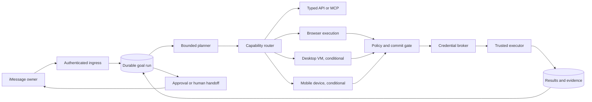

# Personal execution platform plan

Status: phases 0–5 implemented; phases 6–7 evaluated and deferred
Last reviewed: 2026-08-31
Companion decisions:

- [`../decisions/0001-execution-tiers.md`](../decisions/0001-execution-tiers.md)
- [`../decisions/0002-credential-custody.md`](../decisions/0002-credential-custody.md)

Sequential implementation prompt: [`master-codex-prompt.md`](master-codex-prompt.md)

## Objective

Turn OpenInstinct from an approval-gated assistant with bounded browser macros into a durable personal execution platform that can safely complete logged-in, multi-step work.

The owner should be able to ask for an outcome through iMessage, leave, and receive one of four honest results:

1. completed, with evidence;
2. waiting for a narrowly described approval;
3. waiting for a secure human handoff such as login, CAPTCHA, or OTP;
4. unable to confirm the outcome, with reconciliation instructions and no automatic replay.

This plan preserves the product's one-owner-per-deployment model. A “per-owner” browser profile, VM, credential namespace, or device therefore means one bound to that deployment's singleton workspace. It does not introduce multi-tenant behavior into core, database, messaging, or connector packages.

## Non-goals

- Do not give the model plaintext passwords, payment data, OAuth tokens, or live-view capability URLs.
- Do not make arbitrary model-generated JavaScript or shell commands a normal tool surface.
- Do not provision an always-on general-purpose VM when an API connector or isolated browser can do the job.
- Do not use shared public device farms with real owner credentials.
- Do not enable unrestricted financial or security-sensitive action as one launch event.
- Do not turn the web control plane into the primary chat interface.

## Product definition of done

The platform is ready for a real-world task category only when it can:

- enroll the relevant account without exposing credentials to the model;
- determine whether the account session is healthy;
- plan and execute multiple bounded steps while persisting progress;
- pause for approval or human takeover without losing state;
- resume from the exact observed state;
- verify postconditions and capture a redacted receipt or other evidence;
- distinguish a definite pre-effect failure from an ambiguous outcome;
- reconcile ambiguous outcomes read-only before proposing another write;
- enforce owner policy at the irreversible commit point;
- delete or revoke all provider-side state during decommissioning.

## Target architecture



Supabase remains the source of durable truth. Execution providers hold replaceable session state. A provider callback, live browser, VM, or device is never the sole record of progress.

### Capability routing order

Every goal uses the lowest-capability tier that can complete it:

1. typed direct connector;
2. reviewed remote MCP tool;
3. authenticated cloud browser;
4. isolated desktop VM;
5. dedicated mobile device.

Promotion to a higher tier must have a recorded reason such as “no API,” “site requires rendered browser,” “native desktop application,” or “mobile-only application.” Cost, latency, data exposure, and operational risk rise at each tier.

## Workstream A: durable goal execution

### Problem

An approved action currently executes once, discards its result, sends a generic completion message, and closes the run. One run can hold only one pending action. This cannot support booking, cancellation, negotiation, monitoring, or recovery.

### Design

Treat `agent_runs` as durable goal runs and add an append-only step/event layer beneath them.

Proposed database objects:

| Object               | Purpose                                                                        |
| -------------------- | ------------------------------------------------------------------------------ |
| `run_events`         | Append-only normalized observations, results, handoffs, approvals, and wakeups |
| `workflow_steps`     | One planned or executed unit with bounded input, status, attempt, and ordering |
| `tool_results`       | Structured result for a step or action, including outcome certainty            |
| `execution_sessions` | Lease and lifecycle record for a browser, VM, or device session                |
| `artifacts`          | Metadata and hash for screenshots, PDFs, downloads, receipts, and traces       |
| `human_handoffs`     | Secure takeover request, reason, expiry, and completion state                  |

Use Supabase Storage as the default artifact byte store so the default deployment still keeps durable state in Supabase. Keep the artifact interface replaceable for self-hosted deployments. Postgres stores references, hashes, sensitivity, retention, and deletion state. The Data API must never expose raw provider capability URLs or secret-bearing artifacts.

### Execution lifecycle

```text
queued
  -> planning
  -> observing
  -> acting (non-consequential)
  -> waiting_approval | waiting_handoff | waiting_external_event
  -> acting (approved commit)
  -> verifying
  -> completed | failed | unknown
```

The existing top-level run statuses can remain initially. Detailed substates belong to `workflow_steps`, `execution_sessions`, and `waiting_for`, avoiding a breaking proliferation of run status strings.

Every executor result uses one of these certainty classes:

- `succeeded`: postcondition or provider receipt proves completion;
- `failed_before_effect`: no consequential effect could have occurred;
- `failed_after_reversible_effect`: an effect occurred but rollback is known and recorded;
- `unknown`: completion cannot be established, so automatic replay is forbidden;
- `reconciled_succeeded` or `reconciled_failed`: a later read resolved an unknown result.

Only `failed_before_effect` may be automatically retried, and only within a bounded attempt policy.

### Continuation rule

After any tool execution, persist the result and enqueue a continuation event. The model receives the bounded structured result and relevant redacted observations, not provider credentials or unrestricted logs. A run completes only after the model declares the goal satisfied and a deterministic completion check agrees.

An adaptive execution loop must be divided into short durable queue slices. Never depend on one long-lived Vercel request, one worker process, or one CDP connection to finish the goal. Scheduler-only deployments may remain suitable for background work, but interactive takeover and responsive computer use require a continuously running worker or an equivalently low-latency consumer. `doctor` and deployment docs must report when a selected hosting profile cannot meet the configured interaction-latency target.

## Workstream B: browser identity and human takeover

### Browser profile lifecycle

Expand the provider-neutral browser contract to support:

- create, list, inspect, and delete profiles;
- start, reconnect to, checkpoint, and close sessions;
- retrieve a short-lived human takeover capability through a server-mediated route;
- observe DOM/accessibility state and screenshots;
- perform one bounded interaction at a time;
- upload and download explicitly approved files;
- inspect provider session health and profile authentication health;
- start and stop redacted replay capture where supported.

Proposed profile states:

```text
provisioning -> needs_login -> active -> needs_reauth -> revoked
                                      \-> error
```

### Enrollment flow

1. Owner selects “Connect browser account” in the control plane.
2. OpenInstinct creates a profile and a time-bounded login session.
3. The owner opens a server-mediated takeover link.
4. The owner performs login, password, CAPTCHA, recovery, and unexpected permission steps personally.
5. OpenInstinct runs a site-specific read-only health check.
6. The owner grants allowed origins and allowed capability classes.
7. The provider profile reference and policy are persisted; no cookies or passwords enter Postgres.

Do not store the provider live-view URL. Store a session identifier and mint an authenticated, same-owner redirect or proxy response on demand. Expire takeover authorization quickly and invalidate it when the handoff ends.

### Observe-act loop

Replace precomputed 20-step macros with a bounded loop:

1. observe a redacted screenshot plus structured page state;
2. choose one typed action;
3. validate action against current origin, policy, and step budget;
4. execute;
5. persist observation hash and result;
6. repeat or pause.

Initial actions should include navigate, click, type non-secret text, select, scroll, press key, wait-for-condition, open/close tab, accept/dismiss dialog, upload an approved artifact, and capture/download an artifact. Secret entry is a credential-broker operation, not a `type` action.

### Site support registry

Maintain owner-visible site capability records:

- `supported`: tested workflows and postconditions;
- `best_effort`: adaptive browser use with stricter approval;
- `handoff_required`: automation blocked but takeover works;
- `unsupported`: provider or site restrictions make safe completion unreliable.

The registry should be configuration and evidence, not hard-coded model lore. Kernel currently documents unsupported sites including Amazon, LinkedIn, Facebook, Instagram, X, and Reddit; these must be treated as explicit capability gaps during provider verification.

## Workstream C: credential custody

Follow [`../decisions/0002-credential-custody.md`](../decisions/0002-credential-custody.md).

### Core rule

The model selects a credential reference and intended origin. Only a trusted broker/executor can resolve or inject the credential. Plaintext cannot appear in:

- model messages;
- tool arguments or action request JSON;
- browser observations;
- logs, errors, replays, or audit details;
- command arguments;
- client-visible responses.

### Data model

Add owner-visible `credential_items` containing metadata only:

- workspace and credential kind;
- exact allowed origins;
- account label and non-secret username hint;
- status, last verified time, and rotation due time;
- configuration and encryption-key versions used by approval binding.

Add `app_private.credential_secrets`, reachable only through narrowly scoped server-side `packages/db` methods using a direct Postgres connection. Trusted owner-control routes may add, replace, reveal, export, revoke, or delete after the required fresh authentication; the worker may perform validated injection. The table stores encrypted username/password payloads and per-item envelope metadata, receives no Data API grants, and is never returned by a Supabase browser client, browser-facing repository method, or view.

Each item uses a random data-encryption key. A dedicated, versioned credential-vault wrapping key or KMS key-encryption key wraps that item key; do not reuse the connector `SECRET_ENCRYPTION_KEY` as the long-term vault key. AES-256-GCM associated data binds workspace ID, credential ID, credential type, exact allowed origins, and record version. This makes password-vault key rotation independent from connector reconnection and avoids one long-lived raw key directly encrypting every password.

Add append-only `credential_access_events` with item ID, executor, destination origin, reason, run/action ID, result, and timestamp. Never store the plaintext, entered field contents, data-encryption key, or unredacted credential field observation.

### Delivery stages

1. Owner-entered login through live takeover; OpenInstinct stores only profile state.
2. Internal encrypted website credential items plus origin-bound, model-blind form injection.
3. Owner control-plane add, replace, revoke, delete, freshly reauthenticated reveal, and encrypted emergency-export flows.
4. Optional external-vault import/adapters only after the core vault is complete; they are not dependencies.
5. TOTP/OTP brokering only after separate threat modeling and replay/redaction tests.

Existing OAuth/MCP token encryption remains supported while a versioned envelope-encryption migration is designed. Add key IDs and a re-encryption command so rotating `SECRET_ENCRYPTION_KEY` does not require reconnecting every account.

Kernel profiles contain cookies and storage that can authenticate as the owner. Treat profiles as secret-bearing provider state: bind them to one workspace, never expose raw profile data, disable replay around secret entry, audit use, verify deletion, and invalidate them when the corresponding credential or account is revoked. Kernel necessarily processes injected credentials during login, but it is not the password source of truth.

The trusted worker and Kernel transport are inside the secret-processing boundary. JavaScript and remote browser SDKs cannot guarantee perfect plaintext zeroization. Minimize lifetime and copies, prefer buffers and short-lived isolated executor processes where practical, overwrite buffers best-effort, disable core dumps/heap snapshots and secret-bearing tracing, and state this residual risk honestly in the threat model.

Until a dedicated OTP broker is approved, Gmail and other message connectors must redact likely OTP, recovery-code, password-reset, and security-challenge content before it reaches model context. Those messages trigger a human handoff instead of becoming ordinary agent-readable email.

## Workstream D: semantic authority and approvals

### Replace keyword risk inference

Every consequential action must have a structured semantic intent owned by `packages/core`, for example:

```text
effect: create | update | send | purchase | cancel | delete | security_change
resource: reservation | order | message | subscription | account | file
counterparty: stable identifier and display name
origin: exact scheme and host
amount: currency and maximum total, when applicable
reversibility: reversible | conditionally_reversible | irreversible
commit_point: false | true
credential_use: none | session | password | otp | payment
postconditions: bounded assertions
```

The executor derives and revalidates commit facts from the current page or direct connector immediately before the irreversible operation. A model-generated summary is never sufficient evidence that a click is safe.

### Authority model

Add owner-managed `authority_grants` with:

- capability and effect;
- allowed provider, origin, account, counterparty, and resource class;
- per-action and rolling monetary limits;
- start, expiry, quiet hours, and frequency limits;
- whether human takeover or fresh approval is always required;
- configuration version and revocation state.

Default policy remains conservative:

| Action                                      | Initial policy                                                          |
| ------------------------------------------- | ----------------------------------------------------------------------- |
| Public read                                 | Automatic                                                               |
| Authenticated personal read                 | Allowed only for an enrolled origin/profile                             |
| Reversible low-risk write                   | Exact approval, later eligible for a bounded grant                      |
| Communication                               | Exact recipients and body approval; grants require allowlisted contacts |
| Destructive action                          | Fresh exact approval and typed confirmation                             |
| Financial commit                            | Denied until the financial pilot; then exact amount/merchant approval   |
| Password, MFA, recovery, or security change | Human takeover plus fresh approval                                      |

An approval authorizes semantic intent plus guard conditions, not arbitrary future clicks. If the merchant, amount, recipient, origin, or configuration changes, the approval is stale.

### Financial controls

Before enabling purchases, add:

- typed money values and currency normalization;
- tax, fee, tip, and recurring-charge disclosure;
- payment instrument aliases with no secret data;
- a durable `spend_ledger` reserved/committed/released lifecycle;
- merchant and per-action caps;
- duplicate-order detection;
- receipt capture and read-only reconciliation;
- a global financial kill switch.

## Workstream E: evidence, audit, and privacy

Make `audit_events` an actively written append-only security trail. Required events include profile creation/deletion, login handoff, credential access, policy decision, approval, execution start/end, origin change, artifact creation/deletion, unknown outcome, reconciliation, and kill-switch activation.

Evidence requirements:

- hash every input, observation, result, and artifact;
- capture before/after evidence around commit points;
- redact password, OTP, payment, health, and recovery fields before persistence;
- disable provider video/replays by default for secret-bearing sessions;
- default transient screenshots and DOM snapshots to short retention;
- retain receipts and confirmation identifiers only according to owner policy;
- support owner export and deletion;
- verify provider-side profile/session/artifact deletion during decommissioning.

Audit details must be useful without containing raw page bodies, messages, credentials, or capability URLs.

## Workstream F: prompt-injection and execution security

Treat page content, downloads, email, MCP output, and support-chat messages as tainted observations.

Required controls:

- keep remote content in typed observation blocks marked untrusted;
- prohibit remote content from changing policy, tools, destinations, or credential choice;
- enforce origin and network policy outside the model;
- recheck public DNS/IP safety on connections and redirects;
- restrict provider egress where practical;
- scan downloads before they leave the execution environment;
- never execute downloaded code automatically;
- limit file type, size, count, and retention;
- prevent cross-profile artifact and clipboard leakage;
- add malicious-page and indirect-prompt-injection test fixtures;
- establish per-run time, step, token, storage, and provider-cost budgets.

## Workstream G: desktop VM layer

Follow [`../decisions/0001-execution-tiers.md`](../decisions/0001-execution-tiers.md). Do not block the browser roadmap on a VM.

Introduce a provider-neutral `ComputerProvider` only after the Phase 5 spike. The contract must support create/start/pause/resume/terminate, screenshot, typed input, file transfer, bounded process invocation, health, checkpoint, live takeover, network policy, and provider-side deletion.

A VM is justified only for validated tasks requiring at least one of:

- a native desktop application;
- a durable owner filesystem unavailable through browser uploads/downloads;
- a reviewed CLI workflow that cannot run in the worker;
- OS-level integration or document manipulation requiring a GUI;
- a site that works in an ordinary desktop environment but not the browser provider.

Do not promote a workflow to VM in order to bypass a site's access controls, CAPTCHA, bot restrictions, or terms. Provider incompatibility must result in a direct connector, owner takeover, or an honest unsupported classification unless ordinary owner-operated desktop use is permitted and the reviewed automation policy allows it.

Arbitrary shell access must remain an internal executor primitive. The model should receive narrow named operations or a separately sandboxed code-execution policy, never an unrestricted shell with owner credentials.

## Workstream H: mobile device layer

Do not use AWS Device Farm public devices for owner accounts. AWS documents session recording, long artifact retention, cleanup behavior, and advises against sensitive login information. It is suitable for testing, not personal identity custody.

If mobile-only use cases become material:

1. start with a dedicated Android emulator or dedicated physical Android device;
2. bind one device identity to the deployment;
3. require encrypted storage, secure reset/decommissioning, Appium/ADB controls, live takeover, and device-health checks;
4. account for Play Integrity, emulator detection, SIM/SMS, notification, and regional limitations;
5. treat iOS as a separate research program with Apple signing, automation, and platform-policy review.

Phone calls should be implemented through a typed telephony connector with recording/consent policy, not by provisioning a phone merely to place calls.

## Phased delivery

Effort ranges are engineering estimates, not calendar commitments. A phase does not graduate until its exit criteria pass.

### Phase 0 — execution truth and safety foundation (2–3 engineer-weeks)

Deliver:

- result certainty taxonomy and `tool_results`;
- append-only `run_events`, `workflow_steps`, and audit writers;
- persist approved-action output and enqueue continuation;
- classify definite failures separately from unknown outcomes;
- provider-contract fakes with failpoints before and after effects;
- global browser/financial/credential kill switches.

Exit criteria:

- an approved test action returns to the model and completes a second step;
- injected crashes at every execution boundary produce the correct certainty state;
- no ambiguous action is automatically replayed;
- audit coverage exists for every state transition.

### Phase 1 — persistent browser identity and handoff (2–4 engineer-weeks)

Deliver:

- profile create/delete/inspect support in `packages/browser`;
- browser profile lifecycle migration and store methods;
- owner enrollment and reauthentication UX;
- server-mediated short-lived Kernel live takeover;
- authenticated read health checks and profile revocation;
- doctor/smoke checks for browser provider configuration.

Exit criteria:

- owner can enroll a canary account without a secret entering logs or model context;
- a later session resumes the account login;
- expired login creates a handoff and resumes after completion;
- decommissioning removes provider and database profile state.

### Phase 2 — adaptive read-only computer use (3–5 engineer-weeks)

Deliver:

- one-action observe-act loop;
- screenshot plus accessibility/DOM observations;
- tab, dialog, scroll, keyboard, and bounded file primitives;
- execution session leases and reconnection;
- short durable execution slices and continuous-worker latency diagnostics;
- artifact storage, redaction, retention, and deletion;
- site support registry and malicious-page test suite.

Exit criteria:

- read-only research succeeds across a representative site suite;
- restarts can reconnect or safely rebuild from persisted checkpoints;
- no page content can select credentials, widen network access, or change policy;
- provider cost and step budgets terminate runaway loops.

### Phase 3 — resumable low-risk writes (3–5 engineer-weeks)

Deliver:

- semantic action intents and deterministic commit gates;
- continuation after approval and after execution;
- postcondition verification and evidence capture;
- reconciliation jobs for unknown outcomes;
- communication and reversible-write pilot policies.

Exit criteria:

- canary workflows create, update, and cancel reversible test records end-to-end;
- altered origin, recipient, account, or payload invalidates approval;
- every successful action has evidence; every unknown action has a reconciliation path;
- duplicate external effects remain zero under retry/failpoint testing.

### Phase 4 — credential broker (3–6 engineer-weeks)

Deliver:

- `packages/credentials` provider-neutral contract;
- internal encrypted credential-item storage in `app_private`;
- per-item envelope encryption and crash-safe key rotation;
- origin-bound credential references and access audit;
- brokered form injection that bypasses model and action JSON;
- owner add, replace, revoke, delete, reauthenticated reveal, and encrypted emergency export;
- OTP/recovery-message filtering before model context;
- optional external-vault adapters explicitly deferred until after the internal vault passes launch gates.

Exit criteria:

- automated login works on canary sites without plaintext crossing model-visible surfaces;
- wrong-origin and cross-profile injection tests fail closed;
- secret-scanning tests cover logs, errors, artifacts, action payloads, and replays;
- vault revocation makes subsequent use impossible and invalidates associated browser sessions;
- losing the deployment wrapping key has a documented fail-closed recovery outcome.

### Phase 5 — bounded financial pilot (4–8 engineer-weeks)

Deliver:

- structured transaction preflight and final commit approval;
- spend ledger, limits, payment aliases, receipts, and duplicate detection;
- read-only order reconciliation;
- a tiny allowlist of canary merchants or sandbox providers;
- owner-visible global and per-merchant disable controls.

Exit criteria:

- totals and recurring terms are revalidated immediately before commit;
- amount, merchant, or payment-instrument changes invalidate approval;
- timeout-after-commit never causes an automatic second purchase;
- refunds/cancellations have independent authorization and evidence.

### Phase 6 — VM decision spike (2–3 engineer-weeks, then conditional build)

Test three real workflows that browsers cannot perform against the `ComputerProvider` contract. Evaluate at least one managed persistent VM provider and one sandbox/snapshot provider.

Exit criteria for building the VM layer:

- at least two high-value recurring workflows require it;
- browser/API alternatives fail documented acceptance tests;
- secure pause/resume, deletion, network policy, takeover, and artifact handling are demonstrated;
- projected per-owner cost is acceptable and visible to the owner.

If the gate fails, retain the contract proposal and do not ship or operate VMs.

### Phase 7 — Android device pilot, iOS research (conditional)

Run only after mobile-only tasks are a proven product need. Use test accounts until dedicated-device custody, reset, encryption, and retention controls pass review.

## Package-level change map

| Area                   | Planned ownership                                                                                 |
| ---------------------- | ------------------------------------------------------------------------------------------------- |
| `packages/core`        | Semantic intents, authority schemas, outcome taxonomy, state rules, hashes                        |
| `packages/db`          | Repositories for steps, events, results, sessions, artifacts, grants, and audit                   |
| `packages/browser`     | BrowserProvider v2 contract and Kernel adapter                                                    |
| `packages/credentials` | New internal credential broker, origin rules, model-blind injection, and optional future adapters |
| `packages/computer`    | Conditional provider-neutral VM/device contracts and adapters                                     |
| `apps/worker`          | Durable planner/observer/executor continuation and reconciliation                                 |
| `apps/web`             | Enrollment, approvals, grants, takeover, evidence, revocation, kill switches                      |
| `apps/cli`             | Provider setup, doctor, deletion verification, smoke tests                                        |
| `packages/runtime`     | Optional provider configuration and portable deployment capability checks                         |
| `supabase`             | Constraints, RLS, grants, storage policies, migrations, SQL tests                                 |

Provider-specific dependencies remain outside `packages/core`, `packages/db`, `packages/messaging`, and `packages/connectors`.

## Verification program

### Contract tests

All execution providers must pass a common suite for lifecycle, lease expiry, reconnection, observation bounds, action bounds, file bounds, deletion, redaction, timeout, and ambiguous completion.

### Failure-injection matrix

Inject termination:

- before provider invocation;
- after invocation but before response;
- after response but before database commit;
- after database commit but before queue acknowledgement;
- during handoff;
- during credential injection;
- immediately before and after an irreversible commit.

For each point, assert the external effect count, durable outcome, retry eligibility, owner message, and audit trail.

### Security fixtures

Include pages and files that attempt to:

- override system instructions;
- request credentials or OTPs;
- navigate to a lookalike origin;
- exfiltrate clipboard or uploaded files;
- hide a purchase or subscription in ordinary UI;
- change totals between observation and commit;
- trigger downloads or popup chains;
- leak sensitive values into screenshots and error text.

### End-to-end canaries

Maintain dedicated non-production accounts and reversible workflows for login, reauth, form fill, file upload/download, cancellation, communication, and purchase sandbox testing. Never run destructive or financial smoke tests against an owner's live accounts.

Before each phase handoff, run `pnpm check`, `pnpm build`, `pnpm supabase:test`, and the applicable JSON smoke test. Add provider-live tests only behind explicit environment flags and cost limits.

## Operational metrics and launch gates

Track by site, provider, and task category:

- verified goal completion rate;
- human handoff rate and duration;
- approval count per completed goal;
- definite failure and unknown-outcome rates;
- reconciliation success and latency;
- duplicate external effects;
- credential reauth frequency;
- provider minutes, model tokens, artifact bytes, and cost;
- security-policy denials and origin mismatches;
- secret-scanner findings.

Launch gates:

- duplicate financial or destructive effects: zero;
- confirmed secret exposure to model/log/artifact: zero;
- every consequential completion has persisted evidence;
- every provider resource has tested deletion and decommissioning;
- owner-visible disable controls work without provider access.

## First implementation backlog

Create issues in this order:

1. Define result-certainty and workflow-step schemas in `packages/core`.
2. Add migrations, repositories, grants, RLS, and SQL tests for run events, steps, results, and audit writes.
3. Persist action outputs and enqueue model continuation.
4. Add execution failpoints and retry/unknown regression tests.
5. Define BrowserProvider v2 and a fake provider contract suite.
6. Implement Kernel profile lifecycle and live-view retrieval.
7. Build authenticated browser enrollment, takeover, revoke, and delete UX.
8. Add execution sessions with leases and reconnect semantics.
9. Implement adaptive read-only observe-act primitives.
10. Add artifact storage, redaction, retention, and deletion.
11. Replace browser keyword classification with semantic action intents.
12. Add deterministic commit gates and postcondition verification.
13. Add read-only unknown-outcome reconciliation.
14. Define the internal credential broker, private ciphertext schema, and envelope format.
15. Implement origin-bound secret injection, OTP/recovery filtering, and access audit.
16. Add authority grants and owner policy UX.
17. Implement financial types, spend ledger, and sandbox pilot.
18. Run the VM decision spike against measured browser gaps.
19. Run the dedicated Android feasibility spike only if mobile-only demand passes its gate.

## Research references

Provider features must be reverified during implementation; they are replaceable edges, not architectural truth.

- Kernel browsers, profiles, isolation, live view, and lifecycle: <https://www.kernel.sh/docs>
- Kernel live human takeover: <https://www.kernel.sh/docs/browsers/live-view>
- Kernel documented browser limitations: <https://www.kernel.sh/docs/browsers/faq>
- Daytona persistence, Linux/Windows VMs, pause/resume, and snapshots: <https://www.daytona.io/docs/en/persistence/>
- Modal sandbox snapshots and retention: <https://modal.com/docs/guide/sandbox-snapshots>
- Firecracker isolation design: <https://github.com/firecracker-microvm/firecracker/blob/main/docs/design.md>
- AWS Device Farm data protection warning: <https://docs.aws.amazon.com/devicefarm/latest/developerguide/data-protection.html>
- Android virtual devices: <https://developer.android.com/studio/run/managing-avds>
- Apple UI automation: <https://developer.apple.com/documentation/XCUIAutomation>
